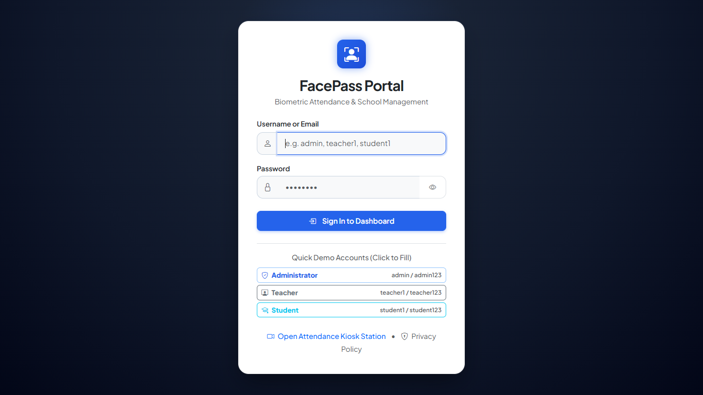
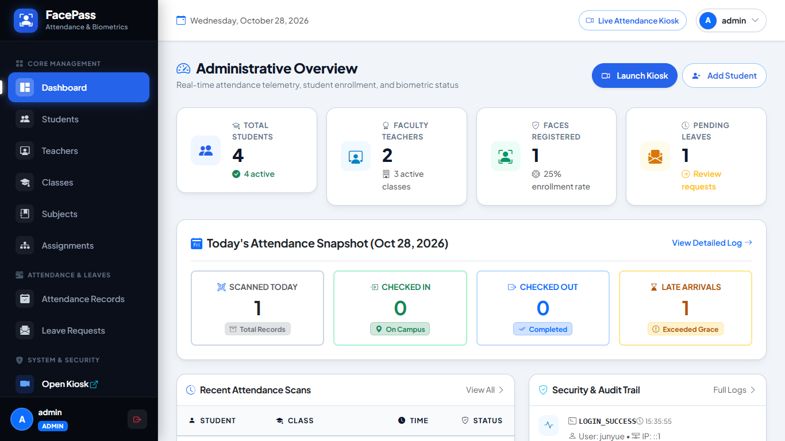
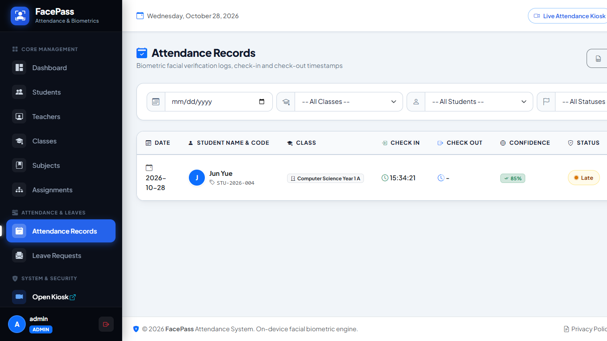
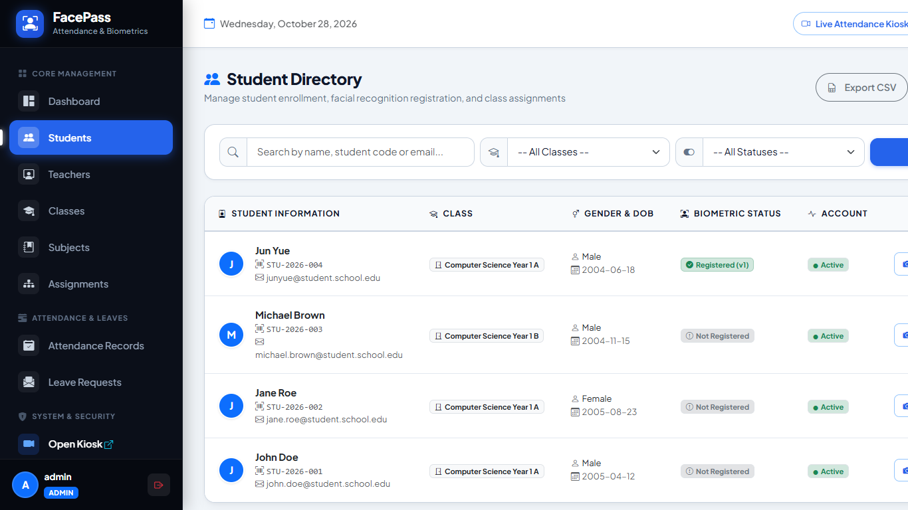
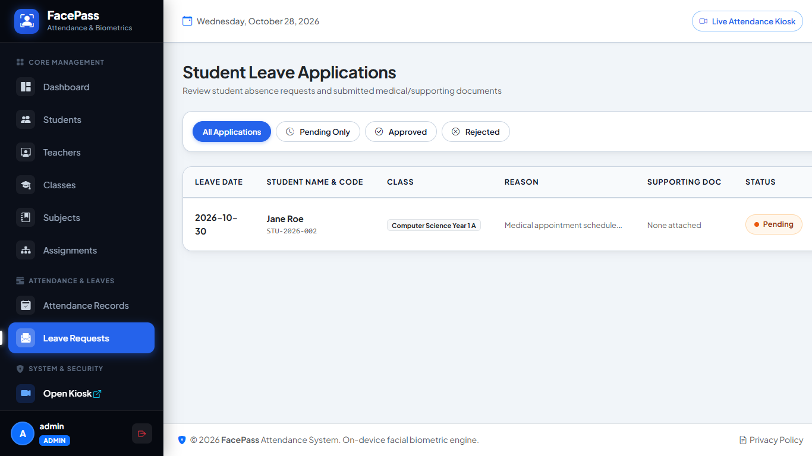

# FacePass: Web-Based Facial Recognition Student Attendance Management System

A full-stack, enterprise-grade, browser-based **Facial Recognition Attendance Management System** developed specifically for educational institutions, academies, and universities. The application features zero external CDN dependencies at runtime, running completely on local Apache/PHP and MariaDB/MySQL environments such as XAMPP.

## 📸 Application Screenshots

| 1. Modern Login & Role Quick-Access | 2. Administrator Analytics Dashboard |
| :---: | :---: |
|  |  |

| 3. Real-Time Attendance Logs & Export | 4. Student Roster & Biometric Status |
| :---: | :---: |
|  |  |

| 5. Student Leave Applications & Approvals |
| :---: |
|  |

---

## 🌟 Key Features

* **Browser-Based Face Recognition**: High-performance detection, 68-point facial landmarks, and 128-dimensional mathematical vector descriptor extraction powered entirely in the browser using `face-api.js`.
* **Zero External CDN Runtime Dependency**: Includes all neural network model weights (`TinyFaceDetector`, `FaceLandmark68Net`, `FaceRecognitionNet`), Bootstrap 5, Bootstrap Icons, and Chart.js hosted completely locally.
* **Dedicated Full-Screen Attendance Kiosk**: High-contrast, reception-ready station with continuous scanning, synthesized Web Audio chimes, live clock, and real-time attendance roll.
* **Strict Quality & Punctuality Engine**:
  * Real-time checks for minimum/maximum face size, frame luminance/brightness, and Laplacian variance sharpness.
  * Late attendance tracking based on class start times and configurable late grace periods.
  * Rest / Break recess check-in and check-out tracking.
  * Anti-duplicate scan cooldown protection (default 300 seconds).
  * Approved leave verification: blocks normal attendance scanning if an excused leave is active.
* **Role-Based Access Control (RBAC)**:
  * **Administrator**: System telemetry, student and faculty directories, class schedules, subject assignments, leave request approvals, face registration/re-registration, audit logs, and settings configuration.
  * **Teacher**: Scoped strictly to assigned classes and students, with date-filtered roll views and individual student analytics.
  * **Student**: Self-service portal with profile, face enrollment/re-enrollment, webcam scanner, attendance history, Chart.js analytics, and leave application uploads (PDF, JPG, PNG).
* **Exporting & Reporting**: Export attendance logs to CSV and Excel-compatible formats, and student rosters to CSV.
* **Audit Trail**: Detailed logging of user logins, logouts, student creations, biometric registrations, and settings modifications with client IP and browser headers.

---

## 💻 Technology Requirements

* **Operating System**: Windows / Linux / macOS
* **Web Server**: Apache 2.4+ (with `mod_rewrite` enabled)
* **PHP**: PHP 8.0+ (Tested on PHP 8.2 with PDO, OpenSSL, and FileInfo extensions)
* **Database**: MySQL 8.0+ or MariaDB 10.4+
* **Browser**: Google Chrome, Microsoft Edge, Mozilla Firefox (WebRTC camera support via `localhost` or `HTTPS`)

---

## 🚀 Quick Setup with XAMPP

### Step 1: Clone or Copy Project
Place the project directory into your XAMPP web root:
```text
C:\xampp\htdocs\Face_attendance_system
```

### Step 2: Configure Environment (.env)
A pre-configured `.env` file is included. If creating a new one:
```bash
cp .env.example .env
```
Ensure your database parameters in `.env` match your XAMPP MySQL/MariaDB server:
```ini
APP_NAME="Face Attendance System"
APP_ENV=development
APP_DEBUG=true
APP_URL=http://localhost/Face_attendance_system

DB_CONNECTION=mysql
DB_HOST=127.0.0.1
DB_PORT=3307
DB_DATABASE=face_attendance_db
DB_USERNAME=root
DB_PASSWORD=
```
*(Note: Default XAMPP MySQL port is typically `3306` or `3307`).*

### Step 3: Initialize Database
You can initialize the database using either:

**Option A: CLI Migration Runner (Fastest)**
Open your terminal in the project directory and run:
```bash
php database/migrate.php
```

**Option B: phpMyAdmin Import**
1. Open [http://localhost/phpmyadmin](http://localhost/phpmyadmin).
2. Click **Import** and choose `database/install.sql`.
3. Click **Import** to execute the script.

### Step 4: Access Application
Open your browser and navigate to:
```text
http://localhost/Face_attendance_system
```
Or directly access the public folder:
```text
http://localhost/Face_attendance_system/public/
```

---

## 🔑 Demo Login Accounts

All demo accounts are pre-seeded with secure Bcrypt password hashes in `install.sql`:

| Role | Username | Password | Notes |
| :--- | :--- | :--- | :--- |
| **Administrator** | `admin` | `admin123` | Full system access, settings & audit logs |
| **Teacher** | `teacher1` | `teacher123` | Alice Teacher (Assigned to CS Year 1 A & B) |
| **Teacher** | `teacher2` | `teacher123` | Dr. Bob Smith (Assigned to CS Year 1 A & SE Year 2 A) |
| **Student** | `student1` | `student123` | John Doe (Enrolled in CS Year 1 A) |
| **Student** | `student2` | `student123` | Jane Roe (Enrolled in CS Year 1 A) |
| **Student** | `student3` | `student123` | Michael Brown (Enrolled in CS Year 1 B) |

*(Quick-fill demo buttons are provided on the login screen for instant 1-click access).*

---

## 📷 Camera Permissions & Local AI Models

1. **Camera Permissions**: Modern browsers allow camera access without SSL when running on `localhost` or `127.0.0.1`. Click **Allow** when prompted by your browser.
2. **Local AI Models**: All neural network weights are pre-downloaded and stored in:
   ```text
   public/assets/models/
   ├── tiny_face_detector_model-weights_manifest.json
   ├── tiny_face_detector_model-shard1
   ├── face_landmark_68_model-weights_manifest.json
   ├── face_landmark_68_model-shard1
   ├── face_recognition_model-weights_manifest.json
   ├── face_recognition_model-shard1
   └── face_recognition_model-shard2
   ```

---

## 📁 Project Architecture

The application implements a clean, modular MVC architecture:

```text
Face_attendance_system/
│
├── app/
│   ├── Controllers/
│   │   ├── Admin/               # Dashboard, Students, Teachers, Classes, Subjects,
│   │   │                        # Assignments, Attendance, Leaves, Settings, Audit, Users
│   │   ├── Teacher/             # Teacher Dashboard, Classes & Attendance
│   │   ├── Student/             # Student Dashboard, Profile, Scanner, History, Leaves
│   │   ├── AuthController.php   # Login, Logout, Change Password
│   │   ├── FaceController.php   # Descriptors API & Biometric Registration API
│   │   ├── KioskController.php  # Dedicated Reception Kiosk & Scan Processing
│   │   └── PrivacyController.php# Privacy Policy
│   │
│   ├── Core/                    # Router, Controller, Model, Request, Response, View, Database
│   ├── Helpers/                 # Auth, Csrf, Session, Validator, FileUploader, Url
│   ├── Middleware/              # AuthMiddleware, GuestMiddleware, AdminMiddleware, TeacherMiddleware, StudentMiddleware, CsrfMiddleware
│   ├── Models/                  # Student, Teacher, SchoolClass, Subject, Attendance, Leave, etc.
│   └── Services/                # AttendanceService, FaceService, ExportService
│
├── config/                      # app.php, database.php, routes.php
├── database/                    # install.sql, migrate.php
│
├── public/                      # Front Controller Root
│   ├── assets/
│   │   ├── css/                 # app.css, kiosk.css
│   │   ├── js/face/             # camera.js, face-engine.js, quality.js, pose.js,
│   │   │                        # matcher.js, registration-flow.js, attendance-flow.js, kiosk-flow.js
│   │   ├── models/              # Local face-api neural network weights
│   │   └── vendor/              # Local Bootstrap 5, Bootstrap Icons, Chart.js, face-api.js
│   ├── uploads/                 # Secure storage for leaves, faces, and attendance snapshots
│   └── index.php                # Front controller
│
├── views/                       # layouts, auth, admin, teacher, student, kiosk, privacy, errors
├── .env.example
├── .env
├── .htaccess
└── README.md
```

---

## 🔒 Security & Privacy

* **Local Biometrics**: Face descriptors are mathematical 128-float vectors. Raw biometric video is processed strictly on-device in the browser and never transmitted over the network.
* **SQL Injection Prevention**: All database interactions use PDO prepared statements with bound parameters.
* **CSRF Protection**: Form submissions include cryptographically secure CSRF verification tokens.
* **File Upload Hardening**: Strict MIME-type inspection, extension whitelisting, file size restrictions, randomized filenames, and `.htaccess` script execution prevention in upload directories.
* **Authentication Security**: Passwords are encrypted using PHP `password_hash()` with BCRYPT. Session IDs are regenerated upon authentication.

---

## 🧪 Testing Checklist

Verify your installation using this checklist:

* [x] **Authentication**: Login as `admin`, `teacher1`, and `student1`. Try incorrect credentials to ensure error handling.
* [x] **Role Access**: Attempt accessing `/admin/dashboard` while logged in as a student (HTTP 403 Forbidden verified).
* [x] **Face Registration**: Navigate to `/admin/students/1/face-register` or student `/student/face-register` and capture 3 samples.
* [x] **Attendance Kiosk**: Open `/kiosk` in full screen and verify automatic face identification, sound chime, and instant roll update.
* [x] **Attendance Scanning**: Verify check-in, check-out, late flag calculation, and duplicate scan cooldown notification.
* [x] **Leave Applications**: Submit a leave application with a PDF/JPG document from student account; approve it from admin account.
* [x] **Exports**: Export attendance to CSV and Excel (`.xls`), and students roster to CSV.
* [x] **Audit Trail**: Check `/admin/audit` to confirm all logins, registrations, and scans are logged with client IP.

---

## 📄 License

This project is licensed under the MIT License - see the [LICENSE](LICENSE) file for details.
